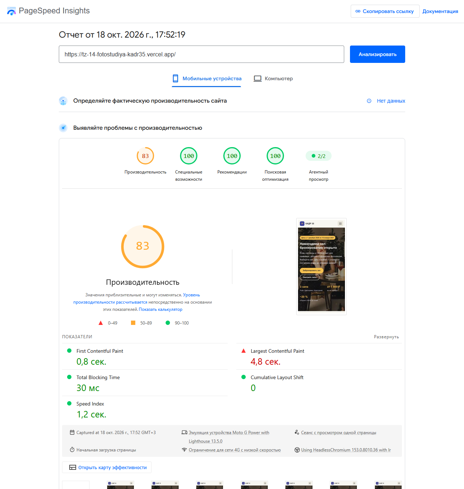
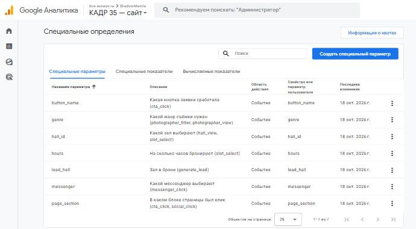
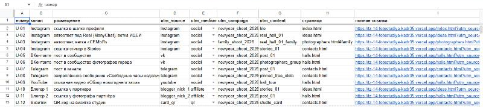
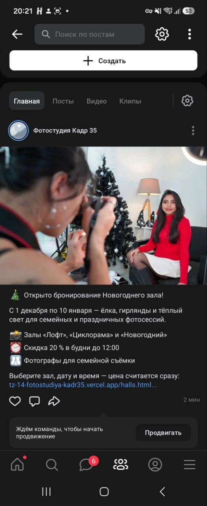
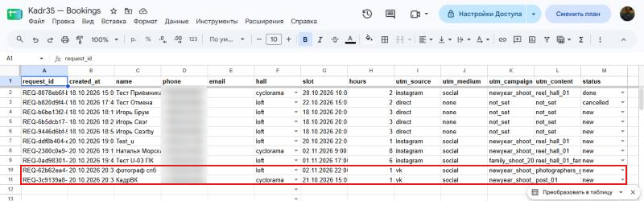
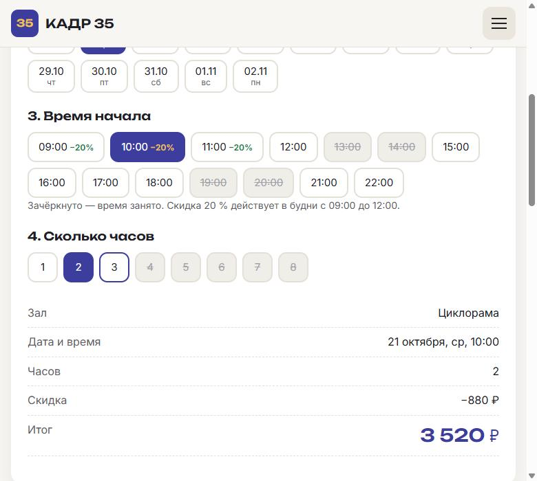
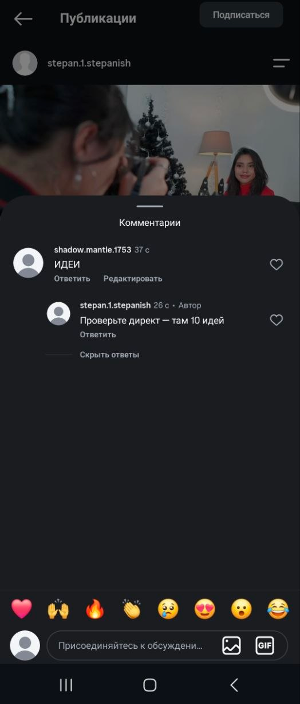
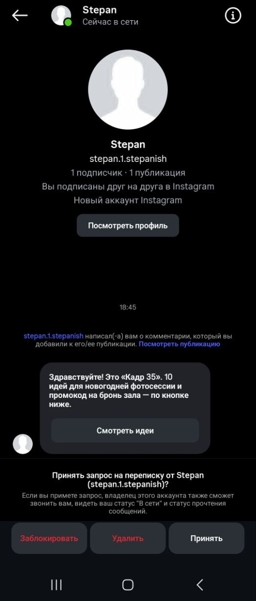
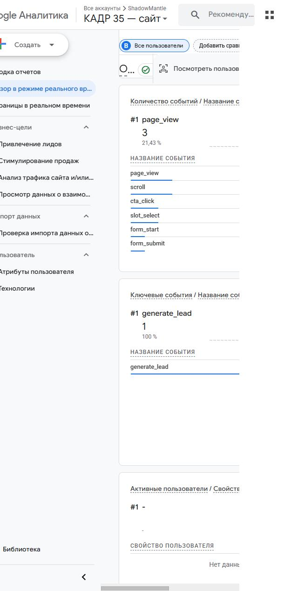

# Описание работы · ТЗ № ТЗ-14/2026 · «Кадр 35»

**Исполнитель:** Бурмистров Вадим Александрович, группа 11/1-РПО-26/1
**Сайт:** https://tz-14-fotostudiya-kadr35.vercel.app
**Период проверок:** 18.10.2026 — 22.10.2026

## 1. Задача заказчика

Фотостудия «Кадр 35» сдаёт три зала: «Лофт», «Циклорама» и сезонный «Новогодний зал». Брони ведутся вручную в Google Календаре администратора, а заявки приходят в Instagram, Telegram и по телефону. В сентябре 2026 года было 2 двойные брони одного зала и около 60 вопросов о свободном времени, на которые ответили позже чем через час. На продвижение уходит 30 000 ₽ в месяц, но студия не знает, какой канал приводит брони, а в декабре 2025 года Новогодний зал был занят на 94 % часов.

Задача — к 1 ноября 2026 года сделать сайт с выбором свободного времени и расчётом стоимости, где у каждого посетителя виден источник, а все брони собираются в одну таблицу со статусом.

## 2. Схема работы

Посетитель приходит из соцсетей, от блогеров или по QR-коду по ссылке с UTM-метками либо получает ссылку в Direct от ManyChat. Сайт отправляет события в GA4, а бронь — в Google Таблицу через Apps Script. По схеме данные GA4 и таблицы должны собираться на дашборде DataLens, но эту часть я не сделал (раздел 10).

## 3. Сайт

Сайт из 9 страниц и страницы 404 создан с помощью Claude Code (Claude Opus 5.5): HTML, CSS и JavaScript без сборки. Страница «Бронь и контакты» показывает свободные часы на 14 дней вперёд, не даёт выбрать время, если хотя бы один час брони занят, и считает итог с утренней скидкой 20 % в будни с 09:00 до 12:00. Например, «Циклорама», будний день, 10:00, 2 часа — 3 520 ₽. «Новогодний зал» доступен только с 1 декабря 2026 по 10 января 2027 года.
Сайт опубликован на Vercel и обновляется после каждого push в `main`.

## 4. Аналитика GA4

Ресурс «КАДР 35 — сайт» (`G-4CEEHYYT51`), часовой пояс Москва, валюта — рубль. Настроено 20 событий, из них своих — 14; все вызовы `gtag('event')` собраны в `js/analytics.js`, кнопки описаны атрибутами `data-event`. Зарегистрировано 7 пользовательских параметров. Ключевые события: `generate_lead`, `contact_click`, `messenger_click`. Каждое событие проверено в DebugView.

## 5. UTM-ссылки и соцсети

В реестре 12 ссылок (лист `utm` и `docs/utm.csv`), полная ссылка собирается формулой СЦЕПИТЬ. Опубликованы 8: Instagram — шапка профиля, два автоответа и сторис (U-01…U-04), ВКонтакте — пост в сообществе студии и в учебной группе фотографов (U-05, U-06), Telegram — пост и закреплённое сообщение (U-07, U-08). Ссылка U-12 — QR-код на афише `docs/afisha.pdf`. Ссылки для YouTube и двух партнёров (U-09…U-11) подготовлены, но не опубликованы.

Группу фотографов ВКонтакте я создал сам, чтобы не писать от имени студии в чужие сообщества. В Telegram вместо канала — публичная группа `t.me/kadr35_studio`, это согласовано с преподавателем.

## 6. Заявки

Форма отправляет бронь через `fetch` в Apps Script. Приёмник построен на основе приёмника из темы 7: проверяет имя, телефон (+7 и 10 цифр), e-mail, зал, время и число часов и записывает строку в лист `leads` вместе с метками `utm_source`, `utm_medium`, `utm_campaign`, `utm_content`. Повторная отправка с тем же `request_id` не создаёт дубль. Событие `generate_lead` уходит в GA4 только после ответа `{"ok": true}`. Администратор ведёт статус брони прямо в таблице: `new → confirmed → prepaid → done` или `cancelled`.

## 7. Автоответы в Instagram

Комментарий «ИДЕИ» под Reel «Новогодний зал: как снимали этот кадр» запускает ответ в комментариях и сообщение в Direct с кнопкой «Смотреть идеи» на `ideas.html`. Вторая ветка — слово «СЕМЬЯ», кнопка «Семейная съёмка» открывает `photographers.html#family`, и фильтр «Семейная» включается сам. Обе ветки проверены: заявка доходит в таблицу с метками своей строки реестра, а в Realtime видно `generate_lead`.

ManyChat запускает автоответ один раз для одного человека под одним постом, поэтому вторую ветку проверял с другого аккаунта. На телефоне Instagram и сайт открывались только через VPN, а с ним события GA4 не доходили, поэтому `generate_lead` для ветки «СЕМЬЯ» снят в Chrome на компьютере по той же ссылке.

## 8. Отчёты и итоги по заявкам

Отчёты GA4 (Reports, Library, Explore) и аналитическая записка — в [report.md](report.md). Главное за период 18–22.10: 17 сеансов, из них Instagram 3, ВКонтакте 3. Воронка page_view → hall_view → cta_click → form_start → generate_lead теряет 90 % посетителей уже на первом шаге: 9 из 10 не открывают ни одной карточки зала. На телефоне до заявки не дошёл никто, на компьютере 1 из 7. Больше всего ключевых событий дал автоответ «СЕМЬЯ» (`reel_hall_01_family`).

Дашборд DataLens я не сделал (раздел 10). Итоги по заявкам ниже посчитаны по листу `leads`.

| Источник | Заявок | Из них |
|---|---|---|
| instagram | 4 | 3 — автоответы ManyChat (ветки ИДЕИ и СЕМЬЯ), 1 — проверка приёмника |
| vk | 2 | по одной с каждого поста |
| direct | 4 | проверки формы и приёмника без меток |
| **Всего** | **10** | статусы: `new` — 8, `done` — 1, `cancelled` — 1 |

Все заявки тестовые, поэтому по ним видно только то, что метки каждого канала доходят до таблицы, а не какой канал лучше.

## 9. Что получил бизнес

| Было | Стало |
|---|---|
| брони в календаре администратора, свободные часы сверяются вручную | на сайте видны свободные часы, занятое время выбрать нельзя |
| вопросы о цене и времени ждут ответа больше часа | итог с утренней скидкой виден до отправки заявки |
| заявки в Instagram, Telegram и по телефону | все брони в одной таблице со статусом |
| 30 000 ₽ в месяц на продвижение без понимания отдачи | у каждой брони есть source, medium, campaign и content — видно, из какого поста она пришла |
| ответы на комментарии вручную | ManyChat отвечает сразу и ведёт на сайт |

Рекомендация заказчику: первый месяц не менять бюджет, а собирать заявки с метками. Через месяц сравнить каналы по числу заявок в статусе `done` и перенести деньги в тот, где их больше. Автоответы ManyChat оставить: они отвечают сразу и ведут на нужную страницу сайта.

## 10. Итог

Не получилось: дашборд DataLens; настройки атрибуции и оповещение по сегменту instagram (в GA4 эти настройки недоступны, подробнее в [report.md](report.md)); публикации на YouTube и у партнёров (U-09…U-11); на телефоне через VPN события GA4 не доходят, поэтому часть проверок снята с компьютера.
ИИ использовался для: кода сайта и Apps Script, текстов по сведениям из ТЗ, схем, этого этого описания, презентации и аналитической записки, настройки отчётов GA4 в браузере; подробно — в [prompts.md](prompts.md).
